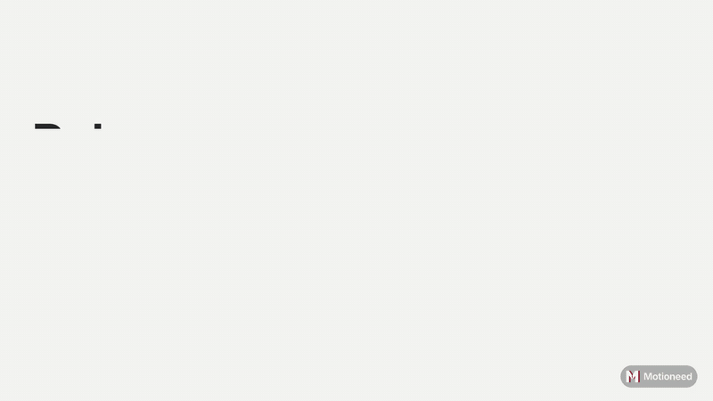

# Motioneed Release Video: turn every GitHub Release into a product launch video

**Motioneed Release Video is a GitHub Action that makes an AI product launch video from your release notes every time you publish a GitHub Release.** It reads your product page for the real brand, colors and interface, writes a short motion video about what is new, and attaches the MP4 to the release. No editor, no screen recording, no designer.

- Release notes and changelog to video, automatically
- Your real product UI, not stock footage or templates
- Screenshots and GIFs in your release notes go on screen, so the video shows what changed
- 16:9 for YouTube and your site, 9:16 for Reels, Shorts, TikTok and LinkedIn
- A public share link and the MP4 on the release
- Made by [Motioneed](https://www.motioneed.com?ref=action), an AI video generator for product launches, demos and ads

## Example

This video was made by this action from a real release: a 30-second demo with narration, from the release notes and one prompt.

[](https://www.motioneed.com/s/949b15a17306a3c7d3aeb1994de8b616)

[Watch it with sound](https://www.motioneed.com/s/949b15a17306a3c7d3aeb1994de8b616)

## Quick start

1. Create an API key at [motioneed.com/account](https://www.motioneed.com/account?ref=action) (paid plans and credit packs).
2. Add it to your repository as the secret `MOTIONEED_API_KEY`.
3. Add `.github/workflows/release-video.yml`:

```yaml
name: Release video
on:
  release:
    types: [published]
permissions:
  contents: write   # to attach the MP4 to the release
jobs:
  video:
    runs-on: ubuntu-latest
    steps:
      - uses: motioneed/release-video-action@v1
        with:
          api-key: ${{ secrets.MOTIONEED_API_KEY }}
          url: https://your-product.com
          aspects: "16:9,9:16"
```

Publish a release. About 10 to 15 minutes later the videos are on the release page and in the job summary (a 15-second video took 11 minutes in our runs, 30 seconds with narration 14). For 60 or 90 seconds, raise `timeout-minutes` to `40`.

## Inputs

| Input | Default | What it does |
|---|---|---|
| `api-key` | required | Motioneed API key |
| `url` | | Public product page to read for brand, colors, copy and UI |
| `prompt` | from the release | What the video is about; set it for manual runs |
| `seconds` | `15` | 10, 15, 30, 60 or 90 |
| `aspects` | `16:9` | Comma list for one video per frame: 16:9, 9:16, 4:3, 3:4 |
| `purpose` | `launch` | launch, demo or ad |
| `voice` | `false` | Add AI narration |
| `upload` | `true` | Attach the MP4 to the release |
| `share` | `true` | Make a public share link |
| `release-images` | `true` | Show the screenshots and GIFs in the release notes |
| `images` | | More images to show, one per line: repo paths or URLs (up to 10 in all) |
| `style-images` | | Images whose look to match, one per line; never shown |
| `timeout-minutes` | `20` | How long to wait |
| `github-token` | `github.token` | Needs `contents: write` to upload |

## Outputs

`video-id`, `video-url`, `share-url`, `studio-url` for the first video, and `videos` as JSON for all of them.

Post the link to Slack or Discord in the next step:

```yaml
      - uses: motioneed/release-video-action@v1
        id: video
        with:
          api-key: ${{ secrets.MOTIONEED_API_KEY }}
          url: https://your-product.com
      - run: |
          curl -X POST -H 'Content-Type: application/json' \
            -d "{\"text\": \"${{ github.event.release.tag_name }} is out: ${{ steps.video.outputs.share-url }}\"}" \
            "${{ secrets.SLACK_WEBHOOK_URL }}"
```

## FAQ

### How do I make a video for every GitHub release automatically?

Add this action to a workflow that runs `on: release: types: [published]`, with your Motioneed API key and your product URL. Each published release gets its own launch video, attached to the release as an MP4.

### How do I turn a changelog or release notes into a video?

The action uses the release name, tag and notes as the brief. It keeps what changed, puts the screenshots and GIFs in the notes on screen, and drops contributor lists, PR links and the Full Changelog line. To write the brief yourself, set `prompt`.

### What does the video look like?

A short motion-graphics video with your real logo, colors, copy and product interface, a music score cut to the beat, and optional narration. See examples at [motioneed.com/showcase](https://www.motioneed.com/showcase?ref=action).

### Can I show my own screenshots?

Yes. Images in the release notes (`` or ``) go on screen in order, PNG, JPEG, WebP or GIF up to 5 MB each, 10 in all. Add more from your repository or the web with `images`, one per line; repo paths need `actions/checkout` before this step:

```yaml
    steps:
      - uses: actions/checkout@v5
      - uses: motioneed/release-video-action@v1
        with:
          api-key: ${{ secrets.MOTIONEED_API_KEY }}
          url: https://your-product.com
          images: |
            docs/screenshots/new-dashboard.png
            https://your-product.com/img/billing.png
```

The action downloads each image itself and sends the job's token only to GitHub hosts, so images in a private repository work too, including `github.com/…/raw/…` and `…/blob/…` links. An image that cannot be read is a warning and the video is made without it.

### How much does it cost?

Each video spends Motioneed credits at the same rate as the web studio. Credits are returned if a video fails. See [pricing](https://www.motioneed.com/billing?ref=action).

### Can I edit the video after it is made?

Yes. `studio-url` opens it in the Motioneed studio, where you can revise it in plain words, or use `revise_video` from the [API or MCP server](https://www.motioneed.com/developers?ref=action).

### Can my AI agent do this without GitHub Actions?

Yes. Motioneed has a REST API and an MCP server for Claude, Cursor and other agents. See [motioneed.com/developers](https://www.motioneed.com/developers?ref=action).

## License

MIT
